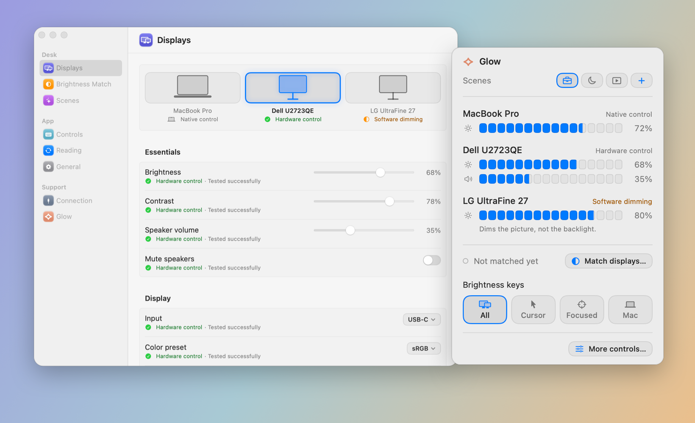
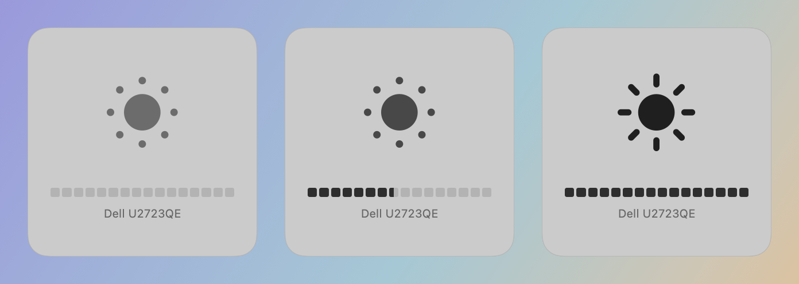

<p align="center">
  <picture>
    <source media="(prefers-color-scheme: dark)" srcset="design/logo/glow-lockup-horizontal-reversed.svg">
    
  </picture>
</p>

<h3 align="center">Every display, in the same light.</h3>

<p align="center">Glow sets the brightness of every screen from your Mac's menu bar, built-in or external, and puts each monitor's own settings on your Mac, so you don't need the buttons on the back.</p>

<p align="center">
  macOS 14 or later · Apple silicon · Free<br>
  <a href="#install">Install</a> · <a href="docs/guide.md">Guide</a> · <a href="#line-apps">Line Apps</a>
</p>

<p align="center">
  <picture>
    <source media="(prefers-color-scheme: dark)" srcset="docs/images/hero-dark.png">
    
  </picture>
</p>

## What it does

- **Glow Desk.** Click Glow in the menu bar for every display's brightness, and volume where a monitor
  has speakers, as sliders or a row of boxes like macOS's.
- **Each monitor's own settings.** Contrast, input, color preset, picture mode, sharpness, the red,
  green and blue levels: Glow asks each monitor what it supports and shows a control for each setting
  it reports. Glow changes them over DDC/CI, the way the monitor's buttons do.
- **The brightness keys.** The keyboard's brightness keys change your monitors too, with an overlay
  like macOS's on the display that changed.
- **Brightness Match.** At the same setting, two displays can look brighter or dimmer than each other.
  Match them once against a grey patch, and they stay alike as you change brightness.
- **Scenes.** Save the values you like on each display, such as "Night", and apply them with one click.
- **Careful with your monitors.** Glow reads each change back to confirm it took, asks before it
  changes input or power, and has a safe mode that only reads.

<p align="center">
  <picture>
    <source media="(prefers-color-scheme: dark)" srcset="docs/images/overlay-dark.png">
    
  </picture>
</p>

The built-in display is set through macOS, and a display Glow can't reach another way is dimmed in
software. Each display says which. The [guide](docs/guide.md) covers every part, with screenshots.

## Install

```sh
brew install --cask millerroberts180/line-apps/glow-app
```

The cask is `glow-app`, because Homebrew already has a different tool called `glow`. Or download Glow
from [its page](https://lineapps.vercel.app/glow/) and drag it to Applications, or get all four apps
at once with the [Line Apps installer](https://lineapps.vercel.app).

Glow isn't notarized yet, so macOS stops it the first time it opens. Choose **Done**, then open
System Settings › Privacy & Security and choose **Open Anyway** beside Glow. On macOS 14,
Control-click Glow in Applications and choose **Open**. A short setup then walks through your
displays, and asks for Accessibility access for the brightness keys.

## Private and careful

- **Nothing leaves your Mac.** No account, no analytics and no network code. Your settings, scenes
  and Brightness Match curves stay in Glow's preferences. To tell displays apart, Glow keeps the
  maker, model and serial numbers each display reports. See the
  [privacy policy](docs/legal/privacy-policy.md), a draft for legal review.
- **Only what the monitor answers for.** A setting becomes editable only after the monitor answers
  a read for it, and Glow writes nothing outside its own catalogue of known settings.
- **Native.** Swift, SwiftUI and AppKit, with no package dependencies.

## Requirements

- macOS 14 or later, on a Mac with Apple silicon. Builds from source are universal, but on an Intel
  Mac Glow could only dim external monitors in software, and it hasn't been run on one.
- For hardware control, a monitor with DDC/CI switched on, connected by a cable that carries it. Some
  hubs and adapters don't pass DDC/CI through; Glow dims those monitors in software instead.
- The Accessibility permission, for the brightness keys.

Glow 0.1.0 is an early release. Its DDC/CI control is tested end to end against simulated monitors
that speak real DDC/CI bytes, and is still to be confirmed on a real monitor; the
[QA report](QA_REPORT.md) has the details.

## Build from source

```sh
scripts/signing-identity.sh   # once per Mac, so the Accessibility grant survives rebuilds
swift run Glow                # run a debug build with this Mac's displays
scripts/bundle.sh             # builds build/Glow.app, universal
open build/Glow.app
scripts/test.sh               # runs the tests
```

You need Swift 6.1 or later; the Command Line Tools are enough. The brightness keys and Open at login
are meant to be used from `build/Glow.app`. The debug flags, simulated monitors, off-screen snapshots
and releasing are in [docs/development.md](docs/development.md).

## Documentation

- **[Guide](docs/guide.md):** Glow Desk, each monitor's settings, the keys, Brightness Match and
  scenes, with screenshots
- **[Development](docs/development.md):** running, debug flags, tests, releasing, and how Glow works
- **[Decisions](docs/adr/):** capability-driven control, reading displays, and collapsing into Line
  Apps
- **[Research](docs/research/displaybuddy-vs-monitorcontrol.md):** how MonitorControl, from its open
  source, and DisplayBuddy, from its public pages, find and control displays
- **[QA report](QA_REPORT.md):** what has been verified, and what hasn't
- **[Releasing](docs/release.md):** signing, notarizing and the launch checklist
- **[Logo](design/logo/README.md):** the mark, its colours and its files
- **[Legal](docs/legal):** the EULA and privacy policy, drafts for legal review
- **[Third-party notices](THIRD_PARTY_NOTICES.md):** MonitorControl's licence, for the parts of its
  DDC approach Glow adapts

## Line Apps

Glow is one of four small Mac apps with one maker and one quiet design, each doing one job:

| App | What it does |
| --- | --- |
| **[Tuck](https://github.com/millerroberts180/tuck)** | Windows, files, links and notes, kept in your Mac's notch |
| **[Pulse](https://github.com/millerroberts180/pulse)** | Feel web pages through your trackpad, and give typing a nicer sound |
| **[Hum](https://github.com/millerroberts180/hum)** | The song you're playing, as album art in a small floating player |
| **[Glow](https://github.com/millerroberts180/glow)** | Brightness, volume and each monitor's own settings, for every display |

[Line Apps](https://github.com/millerroberts180/line-apps) itself is a short line in the menu bar that
their icons collapse into, and one installer for all four. The
[Homebrew tap](https://github.com/millerroberts180/homebrew-line-apps) has each app's cask.

## Licence

Glow is free to use, with every feature for everyone. © 2026 Miller Roberts. All rights reserved.
