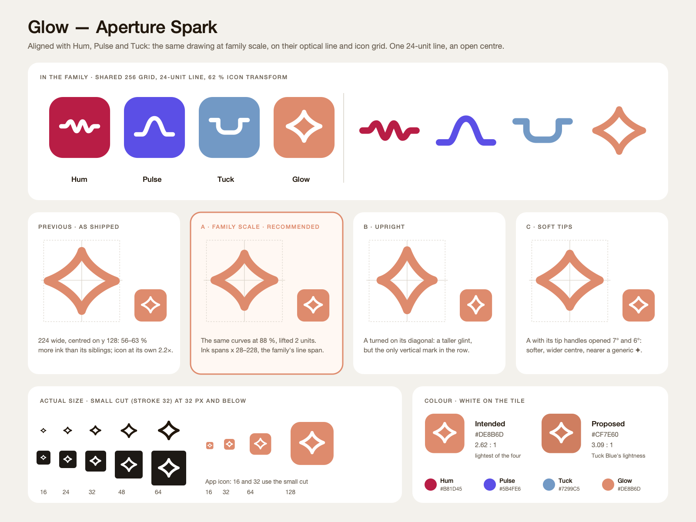

# Glow — Logo Guidelines



## 1. The logo

**Aperture Spark**: a four-point spark of light drawn as one closed, rounded
line, with the centre left open. It is a little wider than it is tall, so it
reads as a flare of light rather than the symmetrical “magic” glyph, and its
long axis runs left to right like Hum’s, Pulse’s and Tuck’s lines.

It’s built the way its siblings are, on a 256-unit grid (unit 8). The tips sit
at (128 48), (216 126), (128 204) and (40 126). Each side is one cubic, `C137 77
168 108` from the top tip to the right tip, mirrored on both axes. The stroke is
24 with round joins, which are the only rounding: the tips meet at 17° either
side of the vertical axis and 20° either side of the horizontal. The ink spans
x 28–228, the span of the siblings’ lines without their caps, and is centred on y 126,
2 units above the grid’s centre: the optical centre all three siblings use. The
masters are stroke-based, so scale the drawing and the stroke together.
`fill="none"` is intentional: the whole interior stays transparent.

| File | Use |
| --- | --- |
| `glow-app-icon.svg` | The macOS app icon: an 824-unit body (radius 186) on the 1024 grid in Apricot Terracotta, with the white symbol at 62 % |
| `glow-app-icon-small.svg` | The same icon drawn with the small cut, for the 16 and 32 px rasters |
| `glow-symbol-orange.svg` / `-black.svg` / `-white.svg` | The symbol on its own, in brand colour, one-colour Ink, and reversed |
| `glow-symbol-small.svg` | For 32 px and below: stroke 32, fuller and slightly larger in its square |
| `glow-symbol-square.svg` | Centred on a square canvas, for avatars |
| `glow-lockup-horizontal.svg` / `-reversed.svg` | The symbol beside the lower-case wordmark, drawn as the same 24-unit line, in Ink and in white for dark backgrounds |
| `glow-concept-board.svg` | The board above: the family, the options, actual-size tests, colour |
| `png/` | The board and transparent PNGs of the icon and symbols, rendered from the SVGs |
| `generate.py` / `render.swift` | The geometry, and the renderer (see section 8) |

## 2. Clear space

Leave 64 units clear on every side of the symbol: a quarter of the grid, about a
third of the spark’s width. That sits inside the family’s range (Hum 23 %, Tuck
about a third, Pulse 39 % of their widths).

## 3. Minimum size

| Version | Screen |
| --- | --- |
| Symbol | 24 px wide; below 32 px use `glow-symbol-small.svg` |
| App icon | 16 px; the 16 and 32 px rasters use `glow-app-icon-small.svg` |

The small cut is centred on y 128, as Hum’s and Pulse’s are, so at 16 px its
2 px line and its tips land on whole pixels.

## 4. Colour

Use one colour and white. Don’t use gradients, glows or shadows on the mark
itself. The app icon’s tile is the only container.

| Name | HEX | RGB | Use |
| --- | --- | --- | --- |
| Apricot Terracotta | `#DE8B6D` | 222 139 109 | App icon body, the symbol in colour |
| Ink | `#21170C` | 33 23 12 | One-colour symbol on light backgrounds |
| White | `#FFFFFF` | 255 255 255 | The symbol on Apricot Terracotta and on dark backgrounds |

White on Apricot Terracotta is 2.62:1. Ink on white is 17.6:1. Apricot on Ink is
6.7:1, so, like Tuck Blue, the coloured symbol also works on dark backgrounds.

**Proposed refinement: `#CF7E60`.** Glow sits in Tuck’s soft tier of the
family palette (OKLCH chroma 0.110; Tuck 0.079, Hum and Pulse 0.19–0.22), but
it is the lightest of the four (L 0.716; Tuck 0.671). `#CF7E60` keeps the hue
(41°) and chroma (0.110) and takes Tuck Blue’s lightness (L 0.673). White on it
becomes 3.09:1, up from 2.62:1, which clears the 3:1 that WCAG asks of
graphics (Tuck Blue is 2.97:1). On Ink it is still 5.7:1. It is the same colour
a step deeper, not a new one. To adopt it, set `BRAND = APRICOT_TUNED` in
`generate.py` and rebuild.

## 5. Typography

There is no wordmark yet. When one is drawn, build it as the siblings’ are:
monoline from the symbol’s 24-unit stroke with round terminals, not set in a
font. Alongside it in the interface, use the system font (SF Pro).

## 6. Family alignment

The previous drawing had the right construction but sat outside the family’s
system in three places. Measured from AppKit renders of each master (units² on
the 256 grid):

| Master | Ink | Convex hull | Ink bounds | Centre |
| --- | ---: | ---: | --- | --- |
| Hum | 7,998 | 12,442 | 224 × 76 | y 126 |
| Pulse | 7,666 | 15,676 | 224 × 112 | y 126 |
| Tuck | 7,713 | 15,382 | 224 × 92 | y 126 |
| Glow, previous | 12,512 | 24,433 | 224 × 200 | y 128 |
| **Glow, now** | **10,990** | **19,812** | **200 × 180** | **y 126** |

- **Optical size.** At the siblings’ full 224-unit ink width, the compact
  spark carried 56–63 % more ink than they do and a hull 1.6–2.0× theirs, so
  it looked a size larger in the row. The drawing is now scaled to 88 % about
  its centre: its side tips end at x 28 and 228, where the siblings’ lines
  end before their round caps, which cuts the ink by 12 % and the hull by
  19 %. A closed line always carries more ink than an open one at the same
  weight. Matching the siblings’ ink outright would take the spark to about
  two-thirds of its previous size (156 units wide), shrinking the open
  centre to 40 % of what it is now and making the mark look smaller than
  its siblings. 88 % is the balance between the two.
- **Optical centre.** Lifted 2 units, to y 126.
- **Icon transform.** The icon used its own `translate(230.4 214.4)
  scale(2.2)`, which drew the line 11 % thinner than its siblings’ and
  centred (128 128) rather than (128 126). It now uses the family’s
  `translate(512 496) scale(2.48) translate(-128 -126)`, so the line has the
  siblings’ weight on the tile. The mark’s footprint barely changed (496 × 446,
  was 492 × 440). White covers 9.8 % of the tile, against the siblings’
  6.8–7.1 %: that is the closed line, and the reason not to go larger.

The curves themselves didn’t change. Uniform scaling keeps the tip angles
(within 0.3° after rounding to whole units) and the depth of the waist, and the
small cut’s geometry was already right. Against the new master its ink ratio is
1.40, inside the family’s 1.39–1.46.

Two corrections to the previous notes: the shipped drawing was wider than
tall, not taller, and the sibling icons don’t shrink their symbol (all three
use 62 %).

### Options

| Option | Construction | For | Against |
| --- | --- | --- | --- |
| **A · Family scale** (recommended, implemented) | The previous curves at 88 %, lifted 2 units | Keeps the original geometry exactly; its long axis echoes the siblings’ horizontal lines; its tips end where the siblings’ lines do | Tips stay pointed (17° and 20°), the sharpest terminals in the family |
| B · Upright | A turned on its diagonal: tips (128 38), (206 126); `C146 86 177 117` | The strongest glint; the vertical light flare the earlier notes described | The only vertical mark in the row; the side rays read stubby |
| C · Soft tips | A with each tip handle turned 7° and 6° outward: `C140 75 171 104` | Softer, nearer Pulse’s “never a spike” rule; 18 % more open centre | Changes the original tips (24° and 26°) and edges towards the generic ✦ |

To try B or C, set `MASTER = UPRIGHT` or `MASTER = SOFT` in `generate.py`.

## 7. Don’ts

- Don’t fill the centre or place a dot inside it.
- Don’t add points, rotate the mark, or sharpen the tips beyond the drawing.
- Don’t stretch it, change the stroke weight on its own, or outline it.
- Don’t recolour it beyond Apricot Terracotta, Ink and White, or add
  gradients, glass, bloom or shadows.
- Don’t place the coloured symbol on busy images or mid-tone backgrounds; use
  the white or Ink version.

## 8. Notes

The geometry lives in `generate.py`; every SVG, including the board, is written
from it, so change the drawing there and never in a single file. Run both steps
from the repository root:

```sh
python3 design/logo/generate.py     # every SVG
swift design/logo/render.swift      # PNGs, drawn by AppKit from those SVGs
```

The SVGs avoid filters, masks and embedded raster data. No trademark search has
been done; run one before relying on the mark publicly.
