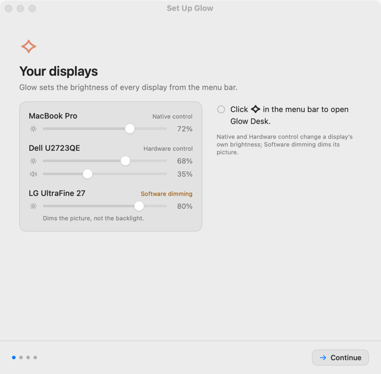
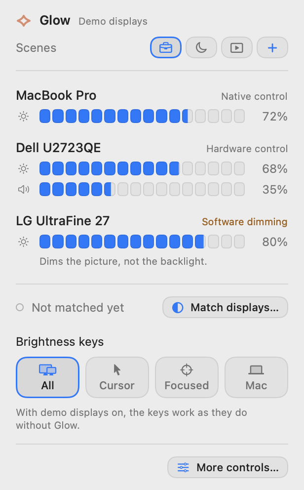
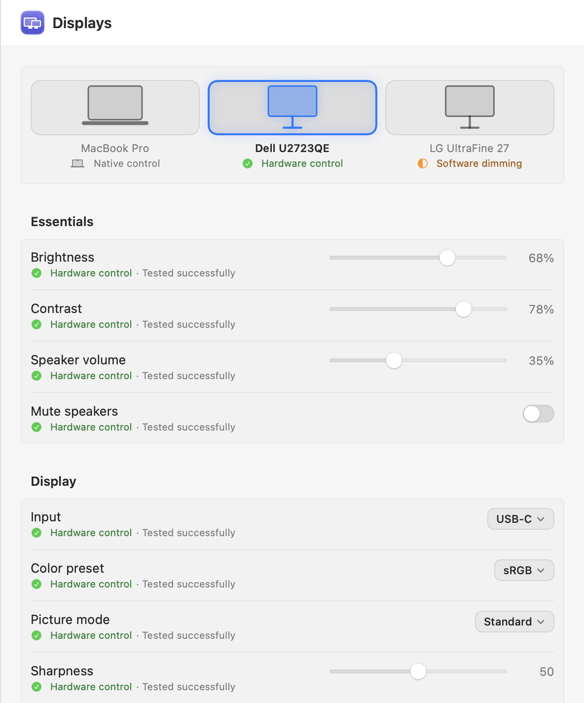
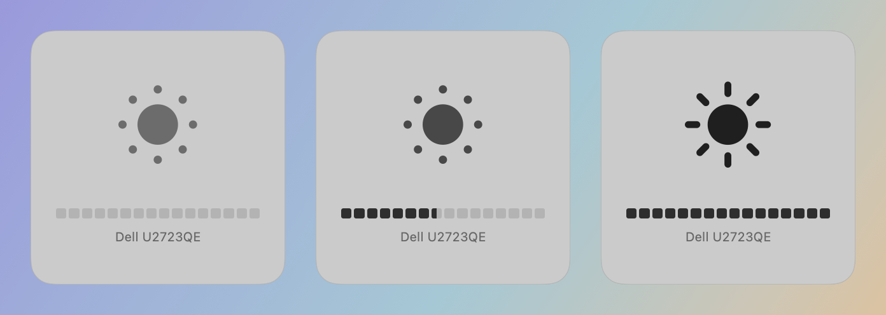
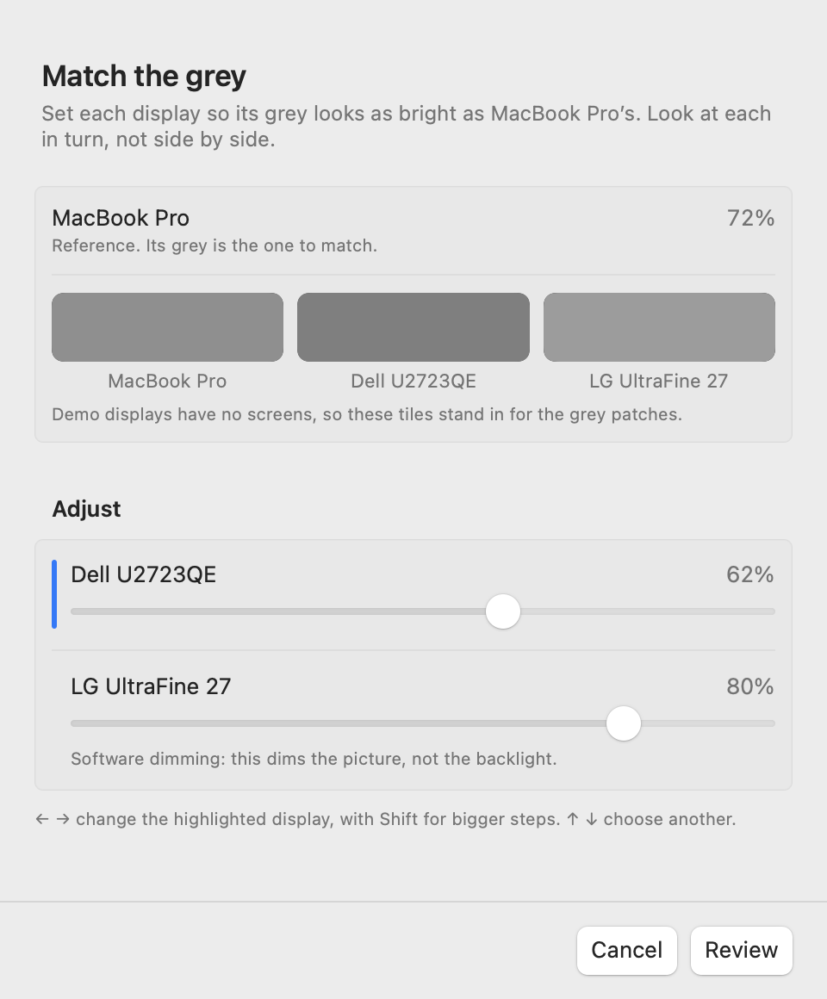
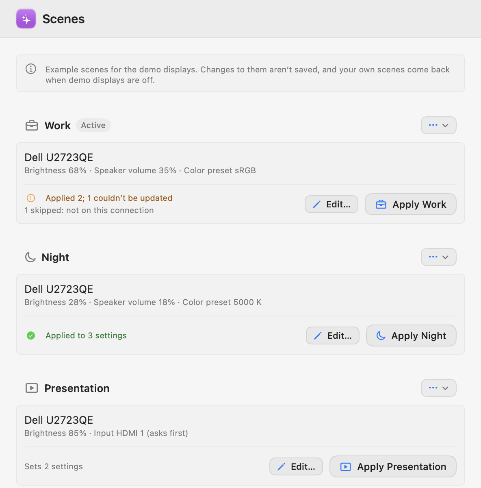

# Glow guide

How each part of Glow works. The screenshots show Glow's three demo displays: turn them on in Settings ›
General to try every screen without a monitor attached. Nothing is sent to real hardware while they're on.

- [Getting started](#getting-started)
- [Glow Desk](#glow-desk)
- [A monitor's own settings](#a-monitors-own-settings)
- [The brightness keys](#the-brightness-keys)
- [Brightness Match](#brightness-match)
- [Scenes](#scenes)
- [Careful with your monitors](#careful-with-your-monitors)
- [With Line Apps](#with-line-apps)
- [Installing and uninstalling](#installing-and-uninstalling)

## Getting started

The first time Glow opens, a short setup shows your own displays in Glow Desk's rows, each with how
Glow sets it, and points at Glow's mark in the menu bar. It ticks off once you open Glow Desk:

<picture>
  <source media="(prefers-color-scheme: dark)" srcset="images/setup-dark.png">
  
</picture>

With two displays or more, you match their brightness next. Pick the display that looks right, and a
grey patch fills each screen while you set the others to look the same. **Not Now** skips this;
Settings › Brightness Match does it later. Then the brightness keys: **Allow…** asks macOS for
Accessibility access, and once it's on, a press of a brightness key ticks the step off as your displays
change. The last step is **Open Glow at login**.

After setup, Glow lives in the menu bar as a four-point spark. Click it for Glow Desk. Right-click or
Control-click it to refresh your displays, open Settings or quit. Settings › General ›
**Open Tutorial…** runs the same steps again, without the permission or open at login. It shows the
keys step only once Glow can take them.

## Glow Desk

Click Glow in the menu bar for every display's brightness, and volume where a monitor has speakers, as
sliders or a row of boxes like macOS's. Your scenes are there too, and the choice of which display the
brightness keys change.

<picture>
  <source media="(prefers-color-scheme: dark)" srcset="images/glow-desk-dark.png">
  
</picture>

Each display says how Glow controls it:

- **Hardware control:** Glow changes the monitor's own settings over DDC/CI, the way its buttons do.
- **Native control:** the built-in display, set through macOS.
- **Software dimming:** a display Glow can't reach another way. Glow dims the picture, not the backlight.

Glow rereads your displays, so a change made with the monitor's own buttons shows up. Settings ›
Reading sets how often.

## A monitor's own settings

Glow asks each monitor what it supports and shows a control for each setting it reports, such as
contrast, input, color preset, picture mode, sharpness and the red, green and blue levels. A setting
becomes editable only after the monitor answers a read for it. Settings › Displays has them all, each
with how Glow controls it and whether it was tested:

<picture>
  <source media="(prefers-color-scheme: dark)" srcset="images/displays-dark.png">
  
</picture>

Settings › Connection shows how Glow reached each monitor, what it tried, and the report to copy if a
monitor doesn't answer.

## The brightness keys

The keyboard's brightness keys change your monitors too. Choose every display, the one under the
pointer, one you pick, or the Mac's own. Hold a key and brightness moves 1 % at a
time until you let go. An overlay like macOS's shows the new level on the display that changed:

<picture>
  <source media="(prefers-color-scheme: dark)" srcset="images/overlay-dark.png">
  
</picture>

Hold Option and Shift with a key for a quarter step. Settings › Controls sets the step size, and
whether levels show as sliders or boxes. The keys need the Accessibility permission, which Glow uses for
the keys and nothing else.

## Brightness Match

At the same setting, two displays can look brighter or dimmer than each other. Match them once and
they stay alike as you change brightness from Glow Desk or the keys. A grey patch fills each screen
while you set the others to look like the one you chose. Quick Match compares once; Guided Match
compares at five levels, from dim to full. It's an appearance match, not color calibration.

<picture>
  <source media="(prefers-color-scheme: dark)" srcset="images/brightness-match-dark.png">
  
</picture>

## Scenes

A scene keeps a set of values for each display, such as "Night", and applies them with one click from
Glow Desk. Glow says exactly what it applied, and what it couldn't and why. A scene that changes input
asks first, and power is never part of one.

<picture>
  <source media="(prefers-color-scheme: dark)" srcset="images/scenes-dark.png">
  
</picture>

## Careful with your monitors

- Glow reads each change back to confirm it took.
- Input and power changes ask first.
- Changes wait while displays sleep or reconnect.
- Hold Shift as Glow opens for safe mode, which only reads.

## With Line Apps

With [Line Apps](https://github.com/millerroberts180/line-apps) (a short line in the menu bar), a click
on the line collapses Glow's spark into it, with Tuck's, Pulse's and Hum's, and another brings them all
back where they were. The brightness keys keep working while the spark is in the line. Glow in the
line's right-click menu, or opening Glow again, opens Settings. Quitting Line Apps brings the spark back.

## Installing and uninstalling

Install with Homebrew:

```sh
brew install --cask millerroberts180/line-apps/glow-app
```

Or download the disk image from [Glow's page](https://lineapps.vercel.app/glow/) and drag Glow to
Applications.

Glow isn't notarized yet, so macOS stops it the first time it opens. Choose **Done**, then open System
Settings › Privacy & Security and choose **Open Anyway** beside Glow. On macOS 14, you can instead
Control-click Glow in Applications and choose **Open**.

To uninstall, quit Glow and run `brew uninstall --cask millerroberts180/line-apps/glow-app`. Add `--zap`
to delete its settings too. Without Homebrew, drag Glow to the Trash and delete
`~/Library/Preferences/com.millerroberts.Glow.plist`.
